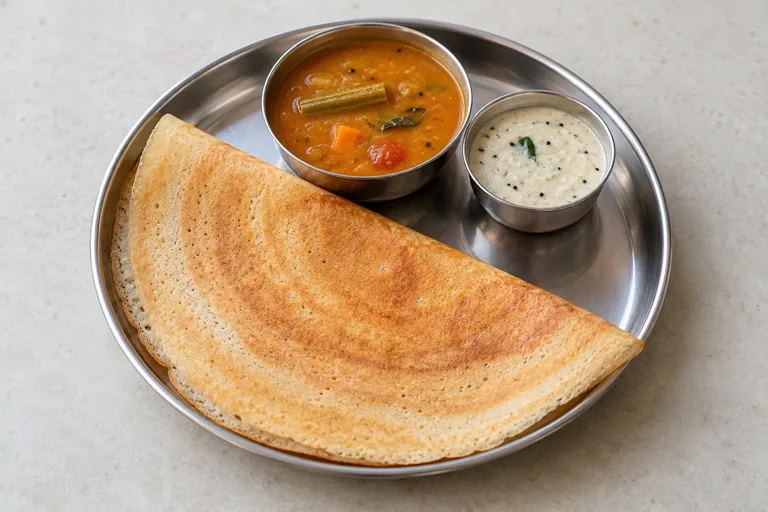
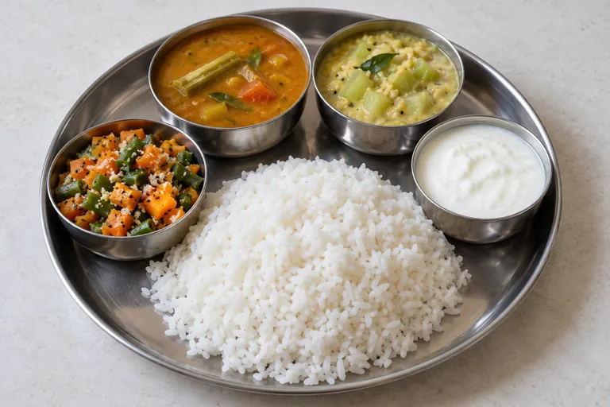
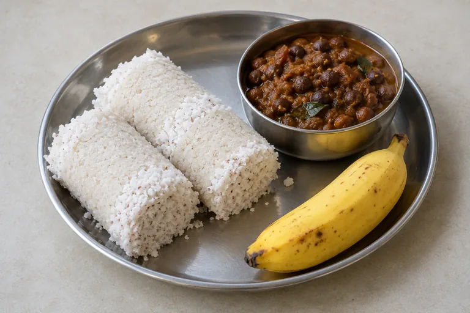

<div align="center">


# Healthy Food

**Simple South Indian meal ideas for everyday buying.**


[Open menu](https://vignesh-s-github.github.io/healthy-food/) · [Features](#what-you-can-do) · [Quick start](#quick-start)

</div>

---

A compact English menu for South Indian restaurant meals, canteen choices, and easy store-bought snacks. Daily picks combine familiar foods and identify protein, fibre, carbohydrate, and other nutrient sources.

<a id="what-you-can-do"></a>

## ✨ What you can do

| Explore | Included content |
|---|---|
| Daily menu | Date-based picks that change at midnight in India, shuffle, vegetarian filter, and saved selections |
| Full menu | **108 choices:** 27 breakfast, 27 lunch, 27 dinner, and 27 snacks |
| Meal details | Example orders, buying options, availability, nutrient sources, and ingredient checks |
| Where to buy | South Indian hotels/restaurants, office canteens, stalls, supermarkets, mall food courts, and quick-commerce services |
| Store list | 24 grocery items with aisle/preparation notes and ready-to-eat versus cooking-required distinctions |
| Dish images | Local generated WebP photos, lazy-loaded and reused for identical pairs |

## 🖼️ Example meal imagery

<p align="center">
  
  
  
</p>

These are AI-generated illustrations of meal ideas, not photographs of named restaurants or measured portions.

<a id="quick-start"></a>

## 🚀 Quick start

```bash
git clone https://github.com/Vignesh-S-GitHub/healthy-food.git
cd healthy-food
python -m http.server 8080
```

Open **http://localhost:8080**. Basic use also works by opening `index.html`. There is no build step or backend; selections are kept in the browser.

1. Browse today's picks or shuffle them.
2. Switch the vegetarian filter if desired.
3. Expand **Details** to see the order, buying options, and nutrient sources.
4. Browse the full breakfast/lunch/dinner/snack sections or store list.

## 🧪 Check the menu

Requires Node.js with its built-in test runner:

```bash
node --test tests/menu.test.cjs
```

When adding a dish, update its details and image reference together. [Image prompts](assets/images/meals/prompts.json) record the generated imagery.

## 📁 Repository guide

[index.html](index.html) provides the structure, [script.js](script.js) contains menus and daily-selection logic, [styles.css](styles.css) defines the compact layout, and [tests/menu.test.cjs](tests/menu.test.cjs) validates menu content.

## 📖 Food information

Nutrient descriptions identify sources; they are not calculated serving totals or individual diet prescriptions. Availability and included sides vary by outlet. Ingredient notes are examples, so confirm ingredients directly when needed.

Reference examples: [South Indian restaurant menu](https://www.sangeethaveg.com/post/sangeetha-veg-restaurant-delivers-chennai-s-most-reliable-veg-dining-every-day) · [Store breakfast products](https://www.bigbasket.com/pb/batter-box/breakfast-snack-mixes/) · [ICMR–NIN guidelines](https://www.nin.res.in/dietaryguidelines2024.html).

## 🤝 Contributing

Open an issue with a reproducible example or submit a focused pull request. Keep setup instructions and documentation aligned with any behavior changes.

## 📄 License

No repository-level `LICENSE` file is currently included.
